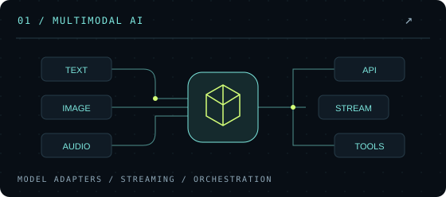
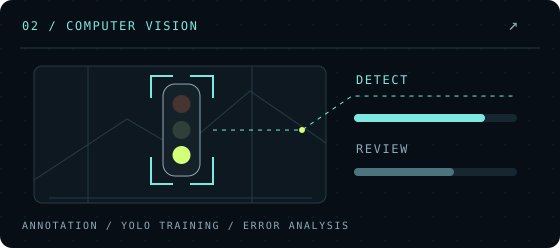
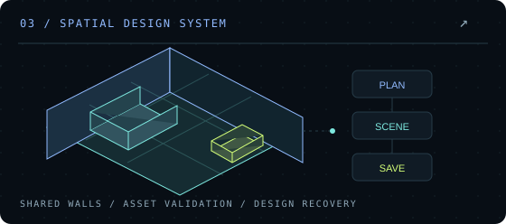
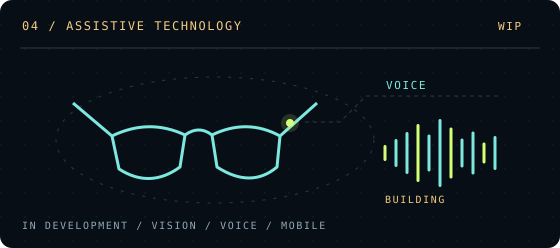

<a href="./README.md">中文</a> &nbsp; / &nbsp; <strong>English</strong> &nbsp; / &nbsp; <a href="./README.ja.md">日本語</a>

<picture>
  <source media="(max-width: 640px)" srcset="./assets/hero-kinetic-mobile-v2.svg" />
  
</picture>

## Hi, I'm lynn

**AI applications · Computer vision · Full-stack & mobile development**

My projects span multimodal inference, vision models, business systems, mobile apps and connected devices. I also build data-processing and interactive 3D tools.

### 01 / Selected work

Selected work across AI infrastructure, vision data, spatial software and on-device systems, with a closer look at architecture and engineering decisions.

<table>
  <tr>
    <td width="50%" valign="top">
      
      <h3><a href="https://github.com/utenkkekou/core-nexus-ai">Core Nexus AI ↗</a></h3>
      
A multimodal gateway combining model contracts, channel routing and streaming with authentication, deduplication, circuit breaking and asynchronous orchestration.

      
FastAPI · Adapter contracts · Service governance

      
<a href="https://github.com/utenkkekou/core-nexus-ai">Source code</a> · <a href="./docs/core-nexus-ai.md">Architecture notes (中文)</a>

    </td>
    <td width="50%" valign="top">
      
      <h3><a href="https://github.com/utenkkekou/PTL-Detect">Vision Data &amp; Model Pipeline ↗</a></h3>
      
From frame extraction and review to training and error analysis, with scene-level splits, duplicate checks and explicit Core ML export contracts.

      
YOLO · Data quality · Error analysis

      
<a href="https://github.com/utenkkekou/PTL-Detect">Source code</a> · <a href="./docs/vision-pipeline.md">Architecture notes (中文)</a>

    </td>
  </tr>
  <tr>
    <td width="50%" valign="top">
      
      <h3><a href="./docs/room-studio.md">3D Room Studio ↗</a></h3>
      
A floor-plan and 3D editor with shared-wall topology, real door/window openings and furniture assets, plus portable backups, version conflicts and draft recovery.

      
Vue · Three.js · Geometry · IndexedDB

      
<a href="./docs/room-studio.md">Architecture notes (中文)</a>

      
Case study · Source private

    </td>
    <td width="50%" valign="top">
      
      <h3><a href="./docs/assistive-vision.md">AI Smart Glasses ↗</a></h3>
      
An on-device visual assistant for people with visual impairments. Domain services, a shared microphone state machine and speech arbitration coordinate perception and accessible interaction.

      
SwiftUI · Core ML · Audio state machines

      
<a href="./docs/assistive-vision.md">Architecture notes (中文)</a>

      
In development · Source private

    </td>
  </tr>
</table>

### 02 / Tech stack

**Languages**

  
  
  
  
  
  

**AI & vision**

  
  
  
  

**Web & mobile**

  
  
  
  
  
  

**Backend & engineering**

  
  
  
  
  
  

Explore the full stack and project tools

| Area | Technologies & tools |
| --- | --- |
| Languages | Python · TypeScript · JavaScript · Go · Dart · Swift · SQL |
| AI & computer vision | PyTorch · Transformers · Diffusers · YOLO · OpenCV · ONNX Runtime · Core ML |
| Web & visualization | React · Next.js · Vue.js · Tailwind CSS · Three.js |
| Backend & APIs | Node.js · FastAPI · NestJS · SQLAlchemy · WebSocket |
| Mobile | Flutter · React Native · Expo · SwiftUI |
| Data & infrastructure | PostgreSQL · MySQL · Redis · MinIO · Docker · Prometheus · Git |
| Additional project tools | FFmpeg · pandas · openpyxl · Hono · Cloudflare Workers · pytest · Playwright |

### 03 / What I build

**AI systems & visual perception**

Unified inference APIs, model integration, text/image/speech/video processing, streaming responses, tool calling and workflow orchestration. Vision work includes image pre-annotation and human review, YOLO training and evaluation, detection and segmentation, ONNX inference and on-device Core ML integration.

**Full-stack applications & delivery**

Web dashboards, API services, role-based access, tenant isolation, and file and media asset management; structured data modeling, CSV/Excel import and cleaning, business reports, and document upload and processing. Delivery work covers Docker deployment, database migrations, asynchronous jobs, WebSocket communication, monitoring metrics and automated tests.

**Mobile devices & spatial interaction**

Flutter, React Native and native iOS apps with camera, location and BLE integration, H.264 video and real-time audio communication. I also build Three.js scenes, floor-plan and spatial visualizations, data dashboards, visual workflows and content-creation interfaces.

### 04 / Currently exploring

- **Vector retrieval & knowledge modeling** — pgvector data models, text-embedding interfaces and retrieval prototypes.
- **Desktop applications** — Electron client prototypes and desktop integration for web applications.
- **Spatial recognition & edge AI** — floor-plan-to-3D recognition pipelines, model quantization and on-device inference optimization.
