
<a href="./README.md">中文</a> &nbsp; / &nbsp; <a href="./README.en.md">English</a> &nbsp; / &nbsp; <strong>日本語</strong>

<picture>
  <source media="(max-width: 640px)" srcset="./assets/hero-prism-mobile-v3.svg" />
  
</picture>

## こんにちは、lynn です

**AI アプリ · コンピュータビジョン · フルスタック・モバイル開発**

創作、仕事、日常で使うツールに AI を取り入れています。個人プロジェクトと [HoshiyomiAI](https://github.com/HoshiyomiAI) での製品開発をまとめ、アイデアが使える機能になるまでを紹介します。リンク先のプロジェクト紹介ページは中国語です。

<a href="#creative">創作・インタラクティブ</a> &nbsp; / &nbsp; <a href="#business">ビジネス・サービス</a> &nbsp; / &nbsp; <a href="#everyday">空間・日常</a> &nbsp; / &nbsp; <a href="#open-tools">オープンなツール</a> &nbsp; / &nbsp; <a href="#toolbox">技術スタック</a>

### 01 / 作品集

画像は用途と機能を表すコンセプト図です。カードから各プロジェクトの紹介へ進めます。非公開プロジェクトは製品紹介のみ掲載しています。

#### 創作・インタラクティブ

物語、動画、キャラクター、音楽を通して、アイデアを育てる場所。

<table>
  <tr>
    <td width="50%" valign="top">
      <a href="./docs/storyloom.md">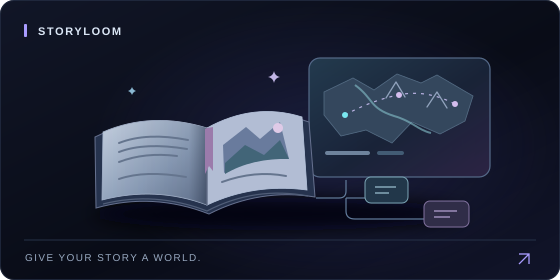</a>
      <h3><a href="./docs/storyloom.md">StoryLoom 织界 ↗</a></h3>
      
構想から世界観や登場人物、章を展開。分岐を比較し、地図や時系列で既存の小説も読み解きます。

      
開発中 · ソースコード非公開

    </td>
    <td width="50%" valign="top">
      <a href="./docs/footage-os.md">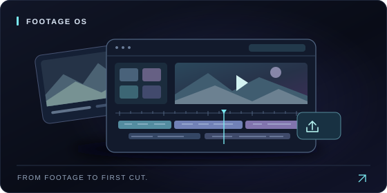</a>
      <h3><a href="./docs/footage-os.md">Footage OS ↗</a></h3>
      
動画素材を整理し、必要な場面を検索。字幕・ラフカット・仕上げの準備を支援し、素材を再利用しやすくします。

      
開発中 · ソースコード非公開

    </td>
  </tr>
  <tr>
    <td width="50%" valign="top">
      <a href="./docs/kirakira.md">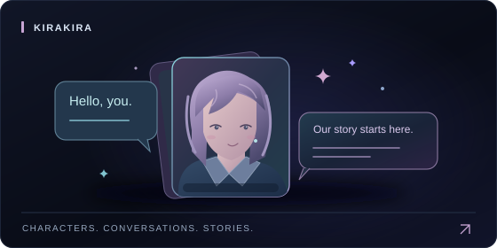</a>
      <h3><a href="./docs/kirakira.md">kirakira ↗</a></h3>
      
AI キャラクターを探す・保存する・創作する。物語の対話、会話の切り替え、思い出の整理で交流を続けます。

      
開発中 · ソースコード非公開

    </td>
    <td width="50%" valign="top">
      <a href="./docs/aurum.md">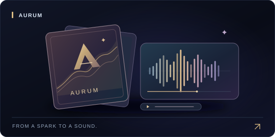</a>
      <h3><a href="./docs/aurum.md">鎏声 AURUM ↗</a></h3>
      
音楽のアイデア、曲調、歌詞の方向性を整理。タスクと作品を確認し、ビジュアルや MV の構想を準備します。

      
創作ワークフローのプロトタイプ · 生成機能を開発中

    </td>
  </tr>
</table>

#### ビジネス・サービス

散らばった情報、コンテンツ、問い合わせを整理し、日々の仕事を進めやすく。

<table>
  <tr>
    <td width="50%" valign="top">
      <a href="./docs/tradewind.md">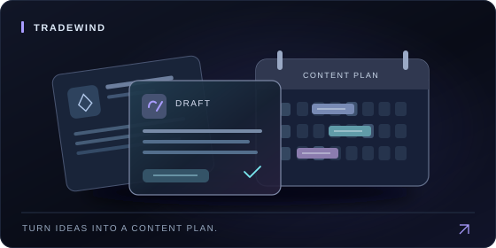</a>
      <h3><a href="./docs/tradewind.md">信風 TradeWind ↗</a></h3>
      
個人開発者や小規模チームのブランド資料・話題・下書き・投稿予定を整理し、公開前の確認を支援します。

      
開発中 · ソースコード非公開

    </td>
    <td width="50%" valign="top">
      <a href="./docs/ai-frontdesk.md">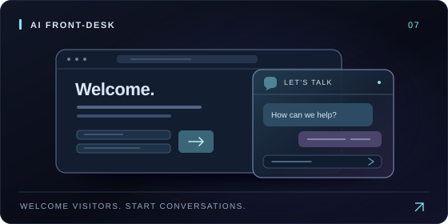</a>
      <h3><a href="./docs/ai-frontdesk.md">AI Front-Desk ↗</a></h3>
      
企業・教育サイトで製品や講座、サービスを案内。連絡先を受け付け、問い合わせ履歴をまとめて確認できます。

      
製品プロトタイプ · ソースコード非公開

    </td>
  </tr>
</table>

#### 空間・日常

住まいを計画し、身の回りの環境を知り、日々のひらめきにも場所を。

<table>
  <tr>
    <td width="50%" valign="top">
      <a href="./docs/room-studio.md">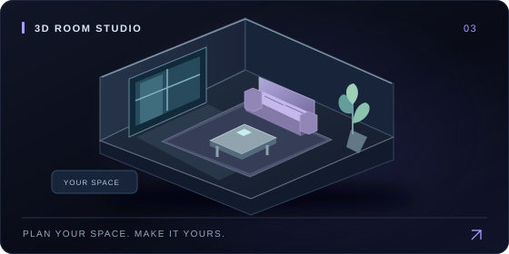</a>
      <h3><a href="./docs/room-studio.md">3D Room Studio ↗</a></h3>
      
間取り作成、家具配置、素材・寸法の調整に対応。異なる設計を保存し、リフォームや家具の組み合わせを比較できます。

      
個人プロジェクト · ソースコード非公開

    </td>
    <td width="50%" valign="top">
      <a href="./docs/assistive-vision.md">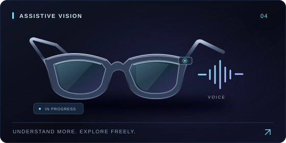</a>
      <h3><a href="./docs/assistive-vision.md">AI スマートグラス ↗</a></h3>
      
音声による周囲の状況説明と経路・操作の案内を通じ、視覚に障害のある方の日常支援を探求しています。

      
開発中 · ソースコード非公開

    </td>
  </tr>
</table>

<table>
  <tr>
    <td>
      <a href="./docs/lumecho.md"><picture><source media="(max-width: 640px)" srcset="./assets/project-lumecho-v1.svg" />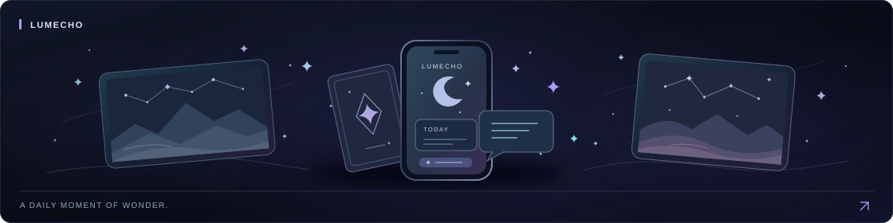</picture></a>
      <h3><a href="./docs/lumecho.md">Lumecho · 命道シリーズ ↗</a></h3>
      
自分だけの星空、カード、日々のインスピレーションを通じて問いやアイデアを記録し、AI ガイドと対話を続けます。文化的な娯楽や自分を振り返るための体験です。

      
開発中 · ソースコード非公開

    </td>
  </tr>
</table>

#### オープンなツール

ソースコードや機能を確認し、自分の用途に合わせてさらに試せるツール。

<table>
  <tr>
    <td width="50%" valign="top">
      <a href="./docs/core-nexus-ai.md">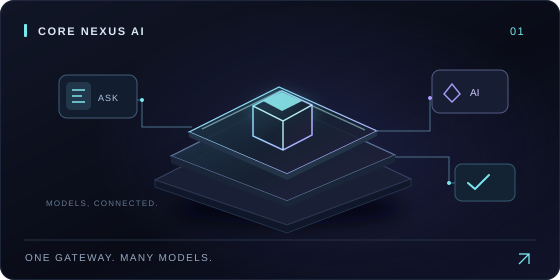</a>
      <h3><a href="./docs/core-nexus-ai.md">Core Nexus AI ↗</a></h3>
      
AI アプリから共通の窓口で異なるモデルを利用。テキスト・画像・音声・動画のリクエストをまとめて扱えます。

      
オープンソースツール · <a href="https://github.com/utenkkekou/core-nexus-ai">ソースコードを見る</a>

    </td>
    <td width="50%" valign="top">
      <a href="./docs/vision-pipeline.md">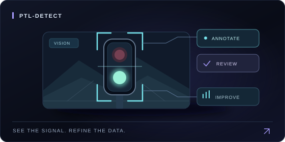</a>
      <h3><a href="./docs/vision-pipeline.md">PTL-Detect ↗</a></h3>
      
歩行者用信号機の動画・画像を整理。アノテーション確認、モデル学習、誤認識の分析を通じて認識精度を改善します。

      
オープンソースツール · <a href="https://github.com/utenkkekou/PTL-Detect">ソースコードを見る</a>

    </td>
  </tr>
</table>

<strong>さらに見る</strong> · アプリ・プロトタイプ・再利用できるツール

**創作・インタラクティブ**

- **[Human-Machine-Love](./docs/project-gallery.md#companion)** — 自分だけの AI キャラクターを作り、対話を続けながら、大切な思い出を確認・編集・保存。開発中。
- **[AI ショートドラマ制作ワークスペース](./docs/project-gallery.md#short-drama)** — 脚本、キャラクター、絵コンテ、カット順を整理。創作ワークフローのプロトタイプ。
- **[YOU & AI](./docs/project-gallery.md#you-and-ai)** — アンケート、レーダーチャート、フィードバックカードで AI の使い方を振り返る、ルールに基づくアンケートのプロトタイプ。

**ビジネス・業務効率**

- **[越境 EC 財務・税務アシスタント](./docs/project-gallery.md#finance-workbench)** — 精算や経費を整理し、資料を確認して、人が照合するための申告下書きを出力。業務アプリのプロトタイプ。
- **[商品検索・調達支援](./docs/project-gallery.md#sourcing)** — 家具や素材を探し、仕様の比較、費用の見積もり、調査記録の保存を支援。自主研究のプロトタイプ。
- **[代替商品検索辞典](./docs/project-gallery.md#shopping-dictionary)** — 別の商品を探すための検索語を検索・保存・共有し、購入の選択肢を広げる製品プロトタイプ。

**暮らし・ツール**

- **[キッチンアシスタント](./docs/project-gallery.md#kitchen)** — レシピの閲覧、食材の記録、今日の献立選びを試せる操作体験のプロトタイプ。
- **[服選び・コーディネート](./docs/project-gallery.md#fashion)** — 商品閲覧、サイズ選び、カート、コーディネート相談を備えた購買体験のプロトタイプ。
- **[AI サービス紹介・要件相談](./docs/project-gallery.md#project-consultant)** — サービス内容を紹介し、対話を通してプロジェクトの要件整理を支援するウェブサイトのプロトタイプ。
- **[TAROT インタラクティブ体験](./docs/project-gallery.md#tarot)** — カードを引き、スプレッドや解釈、履歴を閲覧するモバイル操作体験のプロトタイプ。複数のクライアントをまとめて紹介。
- **[製品開発の基盤](./docs/project-gallery.md#product-foundation)** — 新しいアプリで再利用する、アカウント、会員、通知、日常の運営管理機能。
- **[AI サービス管理の派生開発](./docs/project-gallery.md#service-adaptation)** — オープンソースの New API をベースにした派生開発で、モデルサービスの日常的な管理体験を探求。
- **[Quick Annotation](https://github.com/utenkkekou/Quick-Annotation)** — 画像の事前アノテーションと人による確認のための軽量ツール。ソースコード公開済み。
- **[暦・文化探求ツール](https://github.com/utenkkekou/Metaphysical-data)** — 暦の変換と伝統的な命式計算のための初期ツール。ソースコード公開済み。

[プロジェクト一覧を見る →](./docs/project-gallery.md)

### 02 / 技術スタック

**プログラミング言語**

  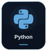
  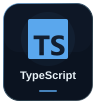
  
  
  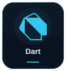
  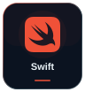

**AI・画像認識**

  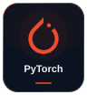
  
  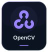
  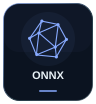

**Web・モバイル**

  
  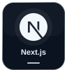
  
  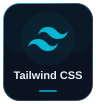
  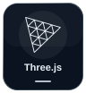
  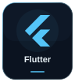

**バックエンド・開発基盤**

  
  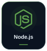
  
  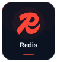
  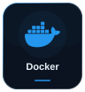
  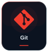

技術スタックとプロジェクトツールの一覧を開く

| 分野 | 技術・ツール |
| --- | --- |
| プログラミング言語 | Python · TypeScript · JavaScript · Go · Dart · Swift · SQL |
| AI・コンピュータビジョン | PyTorch · Transformers · Diffusers · YOLO · OpenCV · ONNX Runtime · Core ML |
| Web・可視化 | React · Next.js · Vue.js · Tailwind CSS · Three.js |
| バックエンド・API | Node.js · FastAPI · NestJS · SQLAlchemy · WebSocket |
| モバイル | Flutter · React Native · Expo · SwiftUI |
| データ・インフラ | PostgreSQL · MySQL · Redis · MinIO · Docker · Prometheus · Git |
| その他のプロジェクトツール | FFmpeg · pandas · openpyxl · Hono · Cloudflare Workers · pytest · Playwright |

---

コンテンツ検索、デスクトップでの創作体験、実空間での視覚支援を引き続き探求しています。
