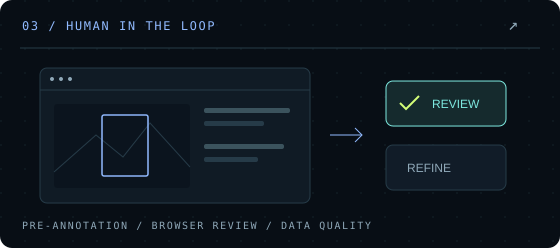

<a href="./README.md">中文</a> &nbsp; / &nbsp; <a href="./README.en.md">English</a> &nbsp; / &nbsp; <strong>日本語</strong>

<picture>
  <source media="(max-width: 640px)" srcset="./assets/header-mobile.svg" />
  
</picture>

## こんにちは、lynn です

**AI アプリケーション · コンピュータビジョン · フルスタック・モバイル開発**

マルチモーダル推論や画像認識から、業務システム、モバイルアプリ、デバイス連携まで。データ処理や 3D インタラクションのツールにも取り組んでいます。

### 01 / 主なプロジェクト

<table>
  <tr>
    <td width="50%" valign="top">
      
      <h3><a href="https://github.com/utenkkekou/core-nexus-ai">Core Nexus AI ↗</a></h3>
      
モデル接続、ストリーミング、認証、タスク処理を統合するマルチモーダル推論ゲートウェイ。オフラインデモを同梱。

      
Python · FastAPI · マルチモーダル AI

    </td>
    <td width="50%" valign="top">
      
      <h3><a href="https://github.com/utenkkekou/PTL-Detect">PTL-Detect ↗</a></h3>
      
歩行者用信号機の画像アノテーション、データレビュー、YOLO の学習・誤認識分析を支援するツール群。

      
Python · YOLO · 画像認識

    </td>
  </tr>
  <tr>
    <td width="50%" valign="top">
      
      <h3><a href="https://github.com/utenkkekou/Quick-Annotation">Quick Annotation ↗</a></h3>
      
信号機画像の事前アノテーションと人手レビューを支援。画像認識 API とブラウザ上のレビュー画面を連携します。

      
Python · 画像認識 · アノテーション

    </td>
    <td width="50%" valign="top">
      
      <h3>AI スマートグラス</h3>
      
<strong>開発中</strong> · 視覚障害のある方を支援するシステム。視覚認識、音声対話、モバイルアプリを連携します。

      
画像認識 · 音声 · アクセシビリティ

    </td>
  </tr>
</table>

### 02 / 取り組んでいる分野

**AI システムと視覚認識**

推論 API の統合、複数モデルの連携、テキスト・画像・音声・動画処理、ストリーミング応答、ツール呼び出し、ワークフロー構築。画像の事前アノテーションと人手レビュー、YOLO の学習・評価、物体検出・セグメンテーション、ONNX 推論、Core ML の端末内統合にも取り組んでいます。

**フルスタックアプリと開発・運用基盤**

Web 管理画面、API サービス、ロールに基づく権限制御、テナント分離、ファイル・メディア資産の管理。構造化データのモデリング、CSV・Excel の取り込みと整形、業務レポート生成、ドキュメントのアップロードと処理。Docker によるデプロイ、DB マイグレーション、非同期ジョブ、WebSocket 通信、監視メトリクス、自動テストまで扱います。

**モバイルデバイスと空間インタラクション**

Flutter、React Native、ネイティブ iOS 開発。カメラ・位置情報・BLE の連携、H.264 映像とリアルタイム音声の通信。Three.js のシーン、間取り・空間の可視化、ダッシュボード、ビジュアルワークフロー、コンテンツ制作画面も開発しています。

### 03 / 技術スタック

`Python` `TypeScript` `PyTorch` `YOLO` `FastAPI` `React` `Three.js` `Flutter` `Docker`

技術スタックと使用ツールをすべて見る

| 分野 | 技術・ツール |
| --- | --- |
| プログラミング言語 | Python · TypeScript · JavaScript · Go · Dart · Swift · SQL |
| AI・コンピュータビジョン | PyTorch · Transformers · Diffusers · YOLO · OpenCV · ONNX Runtime · Core ML |
| Web・可視化 | React · Next.js · Vue.js · Tailwind CSS · Three.js |
| バックエンド・API | Node.js · FastAPI · NestJS · SQLAlchemy · WebSocket |
| モバイル | Flutter · React Native · Expo · SwiftUI |
| データ・インフラ | PostgreSQL · MySQL · Redis · MinIO · Docker · Prometheus · Git |
| その他の使用ツール | FFmpeg · pandas · openpyxl · Hono · Cloudflare Workers · pytest · Playwright |

### 04 / 現在探っていること

- **ベクトル検索・知識モデリング** — pgvector のデータモデル、テキスト埋め込み API、検索プロトタイプ。
- **デスクトップアプリ** — Electron クライアントの試作と Web アプリのデスクトップ統合。
- **空間認識・エッジ AI** — 間取り図から 3D への認識処理、モデル量子化、端末内推論の最適化。
