<strong>中文</strong> &nbsp; / &nbsp; <a href="./README.en.md">English</a> &nbsp; / &nbsp; <a href="./README.ja.md">日本語</a>

<picture>
  <source media="(max-width: 640px)" srcset="./assets/header-mobile.svg" />
  
</picture>

## 你好，我是 lynn

**AI 应用 · 计算机视觉 · 全栈与移动端开发**

从多模态推理、视觉模型，到业务系统、移动应用与智能设备。我也在开发数据处理和 3D 交互工具。

### 01 / 精选项目

<table>
  <tr>
    <td width="50%" valign="top">
      
      <h3><a href="https://github.com/utenkkekou/core-nexus-ai">Core Nexus AI ↗</a></h3>
      
多模态 AI 推理网关，统一模型适配、流式响应、鉴权与任务编排，提供离线演示。

      
Python · FastAPI · 多模态 AI

    </td>
    <td width="50%" valign="top">
      
      <h3><a href="https://github.com/utenkkekou/PTL-Detect">PTL-Detect ↗</a></h3>
      
行人红绿灯视觉工具链，覆盖图片标注、数据复核、YOLO 训练与误判分析。

      
Python · YOLO · 计算机视觉

    </td>
  </tr>
  <tr>
    <td width="50%" valign="top">
      
      <h3><a href="https://github.com/utenkkekou/Quick-Annotation">Quick Annotation ↗</a></h3>
      
交通信号灯图片预标注与人工审核工具，连接视觉 API，在浏览器中逐张审核。

      
Python · 视觉模型 · 数据标注

    </td>
    <td width="50%" valign="top">
      
      <h3>AI 智能眼镜</h3>
      
<strong>开发中</strong> · 面向视障用户的辅助系统，连接视觉感知、语音交互与移动端。

      
计算机视觉 · 语音 · 无障碍

    </td>
  </tr>
</table>

### 02 / 构建方向

**AI 系统与视觉感知**

统一推理 API、多模型接入、文本／图像／语音／视频处理，以及流式响应、工具调用和工作流编排。视觉实践覆盖图片预标注与人工审核、YOLO 训练与评估、目标检测与分割、ONNX 推理及 Core ML 端侧集成。

**全栈应用与工程交付**

Web 管理后台、API 服务、角色权限、租户隔离、文件与媒体资产管理；结构化数据建模、CSV／Excel 导入清洗、业务报表和文档上传与处理。配套 Docker 部署、数据库迁移、异步任务、WebSocket 通信、监控指标与自动化测试。

**移动设备与空间交互**

Flutter、React Native 与原生 iOS 开发，接入相机、定位、BLE、H.264 视频及实时音频通信。也在构建 Three.js 场景、户型与空间可视化、图表大屏、可视化工作流和内容创作界面。

### 03 / 技术栈

`Python` `TypeScript` `PyTorch` `YOLO` `FastAPI` `React` `Three.js` `Flutter` `Docker`

展开完整技术栈与项目工具

| 方向 | 技术与工具 |
| --- | --- |
| 编程语言 | Python · TypeScript · JavaScript · Go · Dart · Swift · SQL |
| AI 与计算机视觉 | PyTorch · Transformers · Diffusers · YOLO · OpenCV · ONNX Runtime · Core ML |
| Web 与可视化 | React · Next.js · Vue.js · Tailwind CSS · Three.js |
| 后端与接口 | Node.js · FastAPI · NestJS · SQLAlchemy · WebSocket |
| 移动端 | Flutter · React Native · Expo · SwiftUI |
| 数据与基础设施 | PostgreSQL · MySQL · Redis · MinIO · Docker · Prometheus · Git |
| 其他项目工具 | FFmpeg · pandas · openpyxl · Hono · Cloudflare Workers · pytest · Playwright |

### 04 / 正在探索

- **向量检索与知识建模** — pgvector 数据模型、文本嵌入接口与检索原型。
- **桌面端应用** — Electron 客户端原型与 Web 应用的桌面集成。
- **空间识别与端侧 AI** — 户型图到 3D 的识别流程、模型量化与设备端推理优化。
