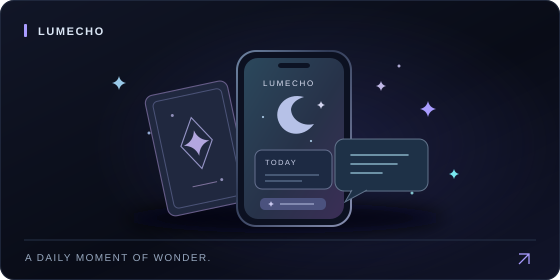

<strong>中文</strong> &nbsp; / &nbsp; <a href="./README.en.md">English</a> &nbsp; / &nbsp; <a href="./README.ja.md">日本語</a>

<picture>
  <source media="(max-width: 640px)" srcset="./assets/hero-prism-mobile-v3.svg" />
  
</picture>

## 你好，我是 lynn

**AI 应用 · 计算机视觉 · 全栈与移动端开发**

我把 AI 做进创作、业务和日常使用的工具。这里整理个人项目与 [HoshiyomiAI](https://github.com/HoshiyomiAI) 的产品实践，记录想法如何变成可以使用的功能。

<a href="#creative">创作与互动</a> &nbsp; / &nbsp; <a href="#business">业务与服务</a> &nbsp; / &nbsp; <a href="#everyday">空间与日常</a> &nbsp; / &nbsp; <a href="#open-tools">开放工具</a> &nbsp; / &nbsp; <a href="#toolbox">技术栈</a>

### 01 / 作品集

配图为用途与功能概念示意。点击卡片了解项目；未公开项目仅提供产品介绍。

#### 创作与互动

从故事、视频到角色和音乐，让想法有一个继续生长的地方。

<table>
  <tr>
    <td width="50%" valign="top">
      
      <h3><a href="./docs/storyloom.md">StoryLoom 织界 ↗</a></h3>
      
从大纲搭建故事世界，发展角色与章节、比较不同分支。也能借助地图和时间轴，梳理已有小说中的人物与事件。

      
开发中 · 源码未公开

    </td>
    <td width="50%" valign="top">
      
      <h3><a href="./docs/footage-os.md">Footage OS ↗</a></h3>
      
为内容创作者整理视频素材、查找片段，辅助字幕与粗剪、准备成片，让已经拍过的内容更容易再次利用。

      
开发中 · 源码未公开

    </td>
  </tr>
  <tr>
    <td width="50%" valign="top">
      
      <h3><a href="./docs/kirakira.md">kirakira ↗</a></h3>
      
发现和收藏喜欢的 AI 角色，也能创作自己的角色设定。通过持续对话、会话管理与回忆整理，让故事继续展开。

      
开发中 · 源码未公开

    </td>
    <td width="50%" valign="top">
      
      <h3><a href="./docs/aurum.md">鎏声 AURUM ↗</a></h3>
      
把音乐灵感、曲风选择、歌词方向与作品整理放进同一个工作台，查看任务进度，并准备视觉风格与 MV 构想。

      
创作流程原型 · 生成能力完善中

    </td>
  </tr>
</table>

#### 业务与服务

把散落的信息、内容和咨询，整理成更容易处理的日常工作。

<table>
  <tr>
    <td width="50%" valign="top">
      
      <h3><a href="./docs/tradewind.md">信风 TradeWind ↗</a></h3>
      
面向独立开发者和小团队，集中整理品牌资料、相关讨论、内容草稿与发布日历，帮助准备内容和完成发布前审核。

      
开发中 · 源码未公开

    </td>
    <td width="50%" valign="top">
      
      <h3><a href="./docs/ai-frontdesk.md">AI Front-Desk ↗</a></h3>
      
为企业和教育网站提供咨询入口，帮助访客了解产品、课程与服务、留下联系信息，让工作人员集中查看咨询记录。

      
产品原型 · 源码未公开

    </td>
  </tr>
</table>

#### 空间与日常

规划居住空间、理解身边环境，也为每天的灵感留一点位置。

<table>
  <tr>
    <td width="50%" valign="top">
      
      <h3><a href="./docs/room-studio.md">3D Room Studio ↗</a></h3>
      
绘制户型、摆放家具，调整材质与尺寸，保存多套空间方案。让装修规划和家具搭配有更直观的比较方式。

      
个人项目 · 源码未公开

    </td>
    <td width="50%" valign="top">
      
      <h3><a href="./docs/assistive-vision.md">AI 智能眼镜 ↗</a></h3>
      
面向视障用户，通过语音了解周围场景，并提供路线与交互提示，探索更易使用的日常视觉辅助体验。

      
开发中 · 源码未公开

    </td>
  </tr>
</table>

<table>
  <tr>
    <td width="50%" valign="middle">
      
    </td>
    <td width="50%" valign="middle">
      <h3><a href="./docs/lumecho.md">Lumecho · 命道探索系列 ↗</a></h3>
      
在个人星空、卡牌与每日灵感中记录问题、收藏想法，再与 AI 向导继续交流。用于文化娱乐与自我观察。

      
开发中 · 源码未公开

    </td>
  </tr>
</table>

#### 开放工具

可以查看源码、了解功能，也可以从自己的使用场景继续探索。

<table>
  <tr>
    <td width="50%" valign="top">
      
      <h3><a href="./docs/core-nexus-ai.md">Core Nexus AI ↗</a></h3>
      
为 AI 应用提供统一的模型使用入口，集中处理文本、图像、语音和视频请求，让不同模型更方便地协同服务。

      
开源工具 · <a href="https://github.com/utenkkekou/core-nexus-ai">查看源码</a>

    </td>
    <td width="50%" valign="top">
      
      <h3><a href="./docs/vision-pipeline.md">PTL-Detect ↗</a></h3>
      
围绕行人信号灯识别，整理视频与图片、复核标注、训练模型并分析误判，帮助持续改进识别效果。

      
开源工具 · <a href="https://github.com/utenkkekou/PTL-Detect">查看源码</a>

    </td>
  </tr>
</table>

<strong>更多探索</strong> · 应用、原型与复用工具

**创作与互动**

- **[Human-Machine-Love](./docs/project-gallery.md#companion)** — 创建个人 AI 角色，延续交流，查看、修改和保存重要回忆。开发中。
- **[AI 短剧创作工作台](./docs/project-gallery.md#short-drama)** — 整理剧本、角色、分镜与镜头顺序。创作流程原型。
- **[YOU & AI](./docs/project-gallery.md#you-and-ai)** — 用问卷、雷达图与反馈卡梳理 AI 使用习惯。规则问卷原型。

**业务与效率**

- **[跨境电商财税助手](./docs/project-gallery.md#finance-workbench)** — 整理结算和费用，检查资料、导出申报草稿以供人工核对。业务应用原型。
- **[商品检索与采购辅助](./docs/project-gallery.md#sourcing)** — 寻找家具与材料，比较规格、估算成本、保留查阅记录。独立研究原型。
- **[平替词典](./docs/project-gallery.md#shopping-dictionary)** — 查找、收藏与分享替代搜索词，探索更多购买选择。产品原型。

**生活与工具**

- **[厨房助手](./docs/project-gallery.md#kitchen)** — 浏览菜谱、记录食材与选择今日菜单。交互原型。
- **[服饰选购与搭配](./docs/project-gallery.md#fashion)** — 商品浏览、尺码选择、购物车与搭配咨询。零售体验原型。
- **[AI 服务展示与需求咨询](./docs/project-gallery.md#project-consultant)** — 展示服务方向，通过对话辅助梳理项目需求。网站原型。
- **[TAROT 互动体验](./docs/project-gallery.md#tarot)** — 抽牌、牌阵、解读与历史回看。移动交互原型，不同客户端合并介绍。
- **[产品基础工程](./docs/project-gallery.md#product-foundation)** — 为新应用复用账户、会员、通知与日常运营管理功能。
- **[AI 服务管理适配](./docs/project-gallery.md#service-adaptation)** — 基于开源 New API 的二次开发，探索模型服务的日常管理体验。
- **[Quick Annotation](https://github.com/utenkkekou/Quick-Annotation)** — 图片预标注与人工复核的轻量工具。源码已公开。
- **[历法与文化探索工具](https://github.com/utenkkekou/Metaphysical-data)** — 历法换算与排盘计算的早期工具。源码已公开。

[浏览完整项目图鉴 →](./docs/project-gallery.md)

### 02 / 技术栈

**编程语言**

  
  
  
  
  
  

**AI 与视觉**

  
  
  
  

**Web 与移动端**

  
  
  
  
  
  

**后端与工程**

  
  
  
  
  
  

展开完整技术栈与项目工具

| 方向 | 技术与工具 |
| --- | --- |
| 编程语言 | Python · TypeScript · JavaScript · Go · Dart · Swift · SQL |
| AI 与计算机视觉 | PyTorch · Transformers · Diffusers · YOLO · OpenCV · ONNX Runtime · Core ML |
| Web 与可视化 | React · Next.js · Vue.js · Tailwind CSS · Three.js |
| 后端与接口 | Node.js · FastAPI · NestJS · SQLAlchemy · WebSocket |
| 移动端 | Flutter · React Native · Expo · SwiftUI |
| 数据与基础设施 | PostgreSQL · MySQL · Redis · MinIO · Docker · Prometheus · Git |
| 其他项目工具 | FFmpeg · pandas · openpyxl · Hono · Cloudflare Workers · pytest · Playwright |

---

继续探索内容检索、桌面创作体验，以及面向真实空间的视觉辅助。
