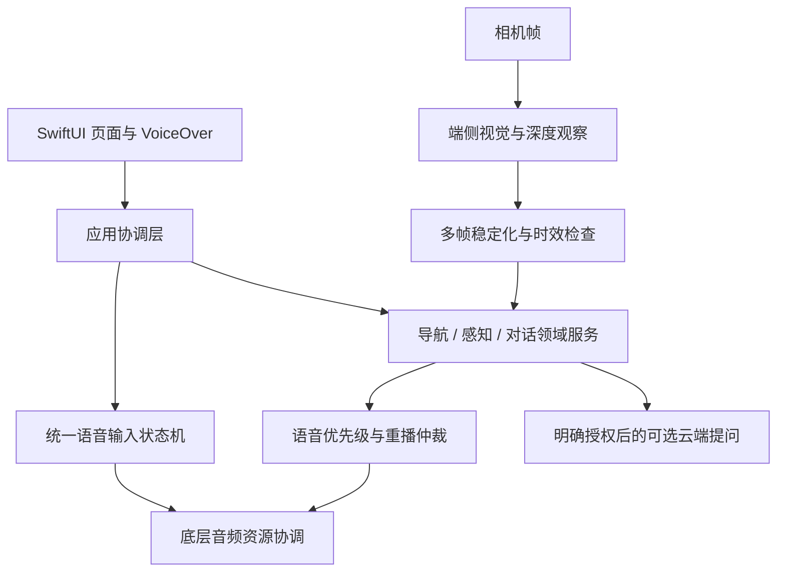

# AI 智能眼镜 / 端侧辅助感知

`SwiftUI` · `Vision / Core ML` · `AVFoundation` · `VoiceOver`

> 开发中的项目案例，源码未公开。此页介绍 iOS 端的辅助感知与交互工程，不代表硬件量产或产品已上线。

## 要解决的问题

视觉助手需要同时处理相机帧、路线信息、用户提问和语音播报。多个功能争用麦克风、切页后异步结果迟到、音频中断未恢复，都会使交互变得不可预测。项目以视障用户的无障碍体验为出发点，把资源管理、任务生命周期和反馈优先级作为核心工程问题。

## 分层架构

## 三项工程决策

1. **统一持有共享设备资源。** 助手、目的地听写和视觉提问通过同一语音输入状态机申请麦克风。任务取消、超时与代际标记共同阻止过期回调重新启动已结束的流程。
2. **把播报作为独立调度问题。** 仲裁层处理优先级、麦克风占用、VoiceOver、重播和恢复状态，领域服务只提交语义明确的消息，避免各模块直接竞争音频输出。
3. **区分观察事实与行动判断。** 本地感知加入多帧稳定化和结果新鲜度检查；相对深度与场景类别各有用途边界。云端能力由明确的用户操作触发，不作为端侧探索启动的前提。

## 已实现与当前边界

已有识别、导航、对话与设置界面，以及端侧视觉模块、音频生命周期管理、语音仲裁、无障碍操作和相应回归测试文件。

项目仍在开发与真机验证中，部分模型具有实验性。观察结果不能单独作为安全通行许可，单目相对深度也不等于可靠米制测距。模型许可、实际配置、设备性能和现场行为仍需逐项验收。本次作品集整理未运行设备构建、真机或部署验收。

[返回主页](../README.md)
