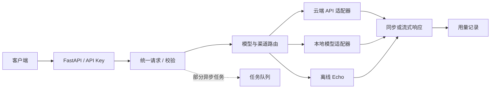

# Core Nexus AI · 多模态推理网关

[← 返回主页](../README.md) · [项目仓库](https://github.com/utenkkekou/core-nexus-ai)

## 问题

本地模型与云端 API 的输入、鉴权和响应方式各不相同。Core Nexus AI 用统一请求协议和适配器承接差异，将模型选择、流式输出和调用治理放入同一后端，让客户端通过一个入口发起请求。

## 架构

## 三个工程决策

1. **统一模型契约。** 适配器围绕 `InferRequest` / `InferResponse` 注册能力，把供应商调用与请求编排分开。新增模型沿用网关入口，真实能力仍取决于对应适配器。
2. **区分请求错误与渠道错误。** 渠道先按优先级排序，同级按权重选择；非流式调用遇到超时、网络错误或 5xx 可尝试下一渠道，4xx 直接失败，已熔断渠道跳过。流式开始输出后不跨渠道回退。
3. **分离管理与推理权限。** 推理使用 API Key，管理接口使用 JWT。调用链包含模型白名单、额度预检、请求去重与用量记录，避免把管理权限交给推理客户端。

## 代码与验证入口

- [编排器](https://github.com/utenkkekou/core-nexus-ai/blob/ca0ea9472489f8d58f366aec1d208e3995aaa813/src/core/orchestrator.py) · [渠道排序](https://github.com/utenkkekou/core-nexus-ai/blob/ca0ea9472489f8d58f366aec1d208e3995aaa813/src/core/router.py)
- [离线适配器](https://github.com/utenkkekou/core-nexus-ai/blob/ca0ea9472489f8d58f366aec1d208e3995aaa813/src/providers/llm/api/demo.py) · [首次启动测试](https://github.com/utenkkekou/core-nexus-ai/blob/ca0ea9472489f8d58f366aec1d208e3995aaa813/tests/test_public_smoke.py)
- [运行说明](https://github.com/utenkkekou/core-nexus-ai/blob/ca0ea9472489f8d58f366aec1d208e3995aaa813/README.md)：安装 `requirements-api.txt` 后运行 `python main.py`，默认监听 `127.0.0.1:9666`。测试代码覆盖未鉴权拒绝、Echo 同步/流式调用与管理员登录。

## 当前边界

公开版预置的 `demo-echo` 只回显输入，不进行 AI 推理。真实模型需额外凭证、依赖或权重；可选集群和存储模块不代表已上线部署。本页依据公开实现整理，此次未重跑服务或模型测试，也不将测试文件存在等同于当前测试通过。
