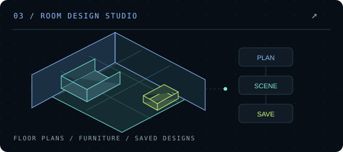

# 3D Room Studio · 空间设计工具

[← 返回主页](../README.md)

## 有什么用

在装修规划或挑选家具时，先把想法放进一个能看、能调整的空间。3D Room Studio 用于绘制房间、安排家具和比较搭配方案，减少只凭平面图片想象空间的困难。

## 可以做什么

- 绘制与调整户型，安排房间、门和窗的位置。
- 摆放家具，调整尺寸、材质与颜色，观察整体效果。
- 保存多套设计，比较不同布局，再继续修改。
- 导出与备份方案，方便以后恢复和接着设计。

适合个人空间规划、家具搭配讨论和设计思路沟通。当前为个人项目，源码暂未公开；本页配图为功能示意，介绍项目用途。
