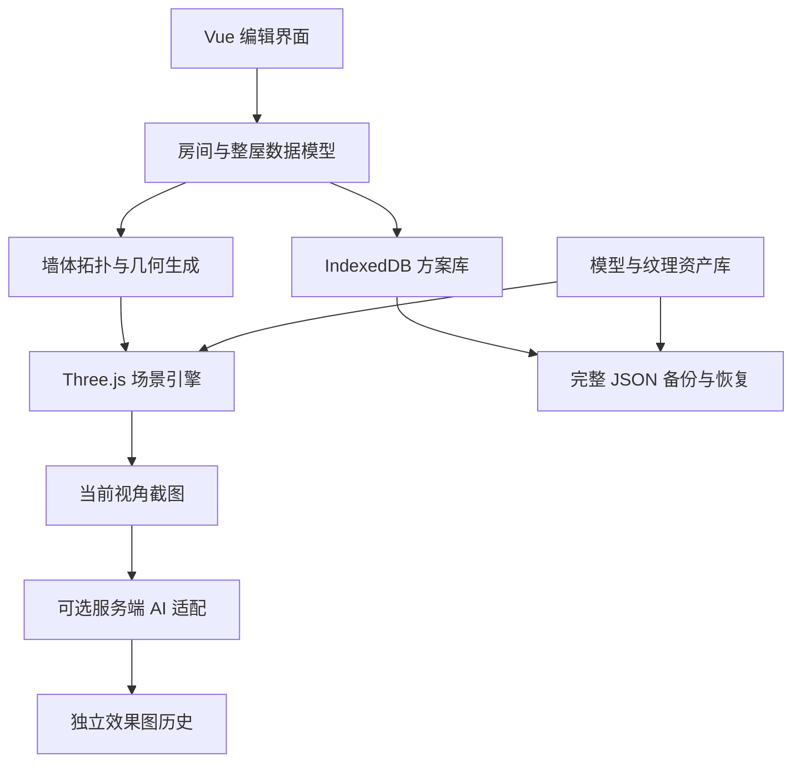

# 3D Room Studio / 空间设计编辑器

`Vue 3` · `TypeScript` · `Three.js` · `IndexedDB`

> 项目案例介绍，源码未公开。以下展示现有设计与实现，不代表已完成生产部署验收。

## 要解决的问题

空间设计工具需要把二维户型、三维场景、家具资产和设计文件保持一致。修改共享墙、移动家具或恢复方案时，不能只让画面看起来正确，还要维护结构关系、资产引用与保存状态。本项目围绕这一完整编辑流程构建浏览器工作台。

## 分层架构

## 三项工程决策

1. **以结构数据驱动场景。** 共边与交汇处归并成物理墙段，门窗按结构开洞；户型修改、家具归属和材质共同进入撤销与保存流程，减少画面与数据脱节。
2. **把本地保存当作可靠性问题处理。** 方案与大体积资产分库存储，使用版本检查识别多标签页冲突，并提供恢复草稿、回收站和完整备份。配额不足或保存失败会明确反馈。
3. **控制资产与模型服务边界。** 导入时校验文件内容、外部引用和资源复杂度；AI 请求经服务端限制来源、并发、时限与预算，凭据不进入浏览器。生成图不会改写可编辑场景。

## 已实现与当前边界

已覆盖单房间与整屋编辑、共享墙门窗、家具材质、撤销重做、多方案管理、JSON 导入导出及效果图工作流，并包含几何、存储、浏览器交互测试和容器部署配置。

当前以本地使用为主，尚无云端多人协作或完整账户系统；户型底图需人工校准描绘，家具体积自动避碰尚未实现。AI 接入默认关闭，相关测试使用模拟服务。本次作品集整理未运行部署或真实模型验收。

[返回主页](../README.md)
