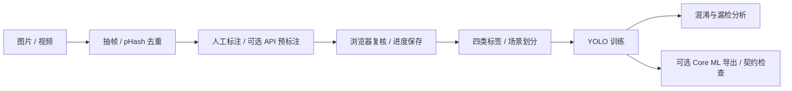

# 视觉数据与模型工具链 · PTL-Detect

[← 返回主页](../README.md) · [项目仓库](https://github.com/utenkkekou/PTL-Detect)

## 问题

行人信号灯检测需要处理小目标、遮挡和车行灯混淆。红灯被识别为绿灯与普通漏检的影响不同，因此工具链把数据复核、类别约定和具体错误类型放在训练指标之外单独检查。

## 架构

## 三个工程决策

1. **让标签贯穿流程。** 红、绿、状态不明的行人灯与车行灯共四类，统一约定用于标注、训练和导出。不确定灯色保留独立类别，复核界面先区分灯种类，再判断状态。
2. **按场景划分数据。** train / val / test 以场景为整体分配，优先保留场景完整性，再兼顾类别覆盖与比例；结合 pHash 检查近重复，减少相邻视频帧跨集合造成的数据泄漏。
3. **检查具体错误和输出契约。** 评估按 IoU 一对一匹配，单独统计红→绿、车行灯→绿灯和漏检。Core ML 导出再检查标签顺序、NMS 与 `confidence N×4`、`coordinates N×4`，防止端侧输出与类别定义错位。

## 代码与验证入口

- [场景划分](https://github.com/utenkkekou/PTL-Detect/blob/3c9eea10802ccac310d93d1dd5674145bc5fdedf/scripts/split_dataset.py) · [误判统计](https://github.com/utenkkekou/PTL-Detect/blob/3c9eea10802ccac310d93d1dd5674145bc5fdedf/ptl/safety.py) · [Core ML 检查](https://github.com/utenkkekou/PTL-Detect/blob/3c9eea10802ccac310d93d1dd5674145bc5fdedf/scripts/export_coreml.py)
- [四类流程测试](https://github.com/utenkkekou/PTL-Detect/blob/3c9eea10802ccac310d93d1dd5674145bc5fdedf/tests/test_four_class_pipeline.py) · [误判指标测试](https://github.com/utenkkekou/PTL-Detect/blob/3c9eea10802ccac310d93d1dd5674145bc5fdedf/tests/test_safety.py)
- [运行说明](https://github.com/utenkkekou/PTL-Detect/blob/3c9eea10802ccac310d93d1dd5674145bc5fdedf/README.md)：安装 `.[dev]`，运行 `python -m tools.review.serve_review` 建立本地复核任务；训练和导出需要另装可选依赖。

## 当前边界

公开仓库提供工具源码与测试，不附带训练数据、权重或真实场景精度结论；导出产物需在兼容环境验证。本页依据公开实现整理，此次未重跑服务或模型测试，现有测试代码不代表现场识别能力已获验证。

相关项目：[Quick Annotation](https://github.com/utenkkekou/Quick-Annotation) 提供另一套图片预标注与人工审核工具；此处仅作关联展示，不表示两仓库已集成。
